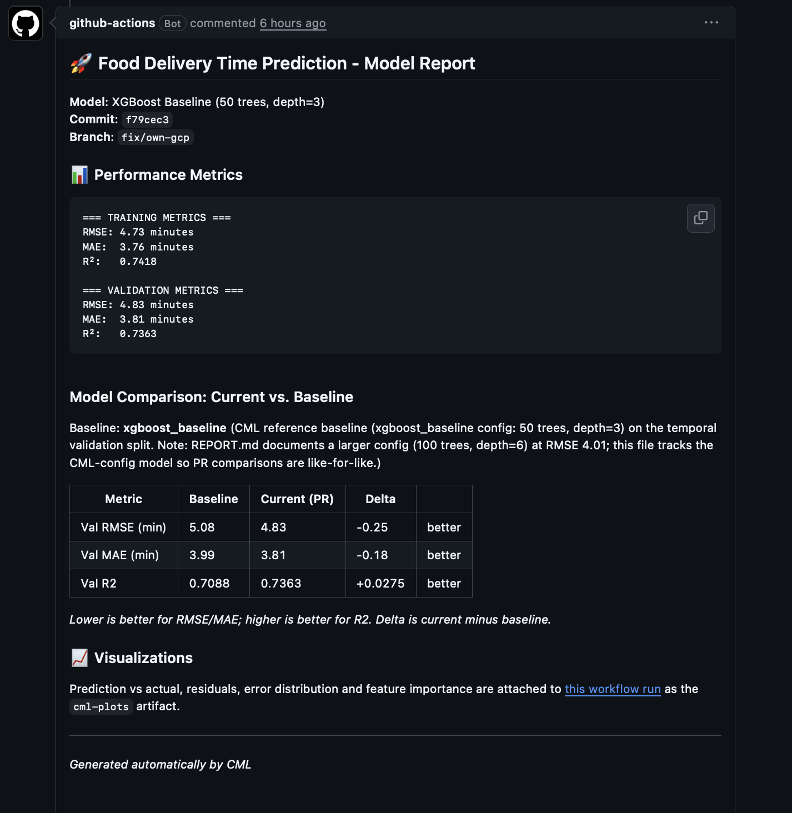
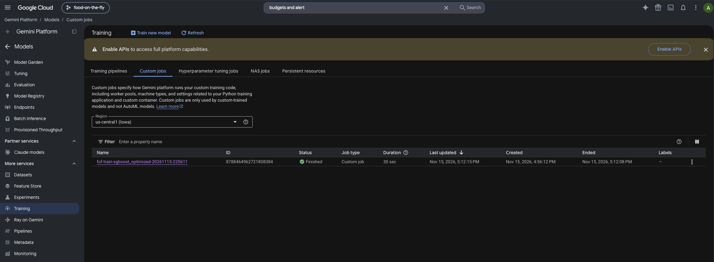
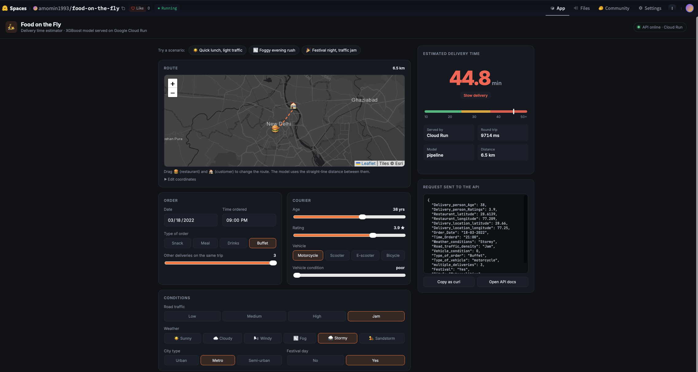
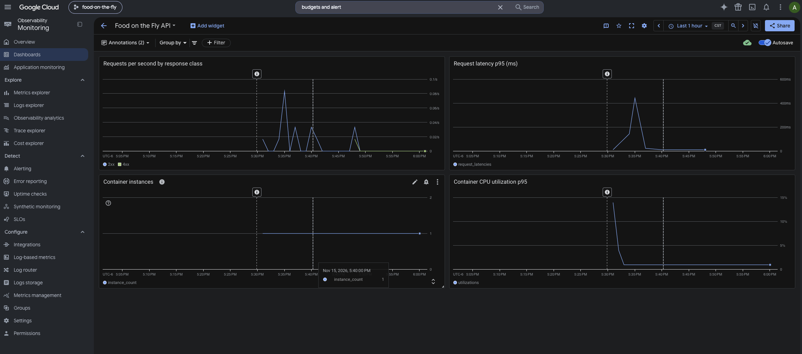

# Food on the Fly: Final Report (Phases 1-3)

**Course:** SE 489 Machine Learning Engineering for Production (MLOps), DePaul University

**Author:** Abdul Momin (Modeling Lead)

**Repository:** https://github.com/amomin1993/food_on_the_fly

**Live app:** https://huggingface.co/spaces/amomin1993/food-on-the-fly

**Demo video:** https://www.youtube.com/watch?v=dnUN4Xo9UOI

**One report per phase:** [Phase 1](REPORT_PHASE1.md), [Phase 2](REPORT_PHASE2.md), [Phase 3](REPORT_PHASE3.md)

**Team (Spring 2026):** Jose Muniz (project lead, platform), Aviv Katz (training pipeline, CML, Docker), Imran Ahmed (data, tests, load testing, UI), Abdul Momin (modeling, profiling, CML comparison)

This report covers all three phases in one document! Phases 1 and 2 and most of Phase 3 were built by the team (including me) in the spring. I finished the outstanding Phase 3 work and the documentation fixes for the rest of the phases on my own in November, in a fork of the team repository so the full commit history and authorship history are kept. Section 5 lists what changed in that completion pass. The detailed checklists with evidence for every item are in `PHASE1.md`, `PHASE2.md` and `PHASE3.md` in the repository. Thank you sincerely for giving me a chance to bring this to completion. I had fun doing this.

---

## 1. Problem and data

Food delivery apps quote an arrival time usually the moment you submit the order. If the quote is too aggressive, the customers are happy at first but will likely get annoyed. On the other hand, if it's too late or padded they will cancel the order and order somewhere else. The goal of Food on the Fly is to predict the delivery time in minutes from what is known at order time:
1. Courier age and rating
2. Restaurant coordinates
3. Drop-off coordinates
4. Order date and time
5. Weather
6. Traffic Density
7. Vehicle Type
8. Vehicle Condition
9. Order Type
10. Number of Deliveries (Concurrent)
11. Festival Flag
12. City Tier

We used the Zomato (Indian delivery service) delivery operations analytics dataset from Kaggle, roughly containing 45,000 orders across Indian cities. The target is 'Time_taken (min)'. The split is chronological and not random. The first 40 days are the modeling window (split 70/15/15) train, validation, and test respectively. Every later week is held back as simulated production traffic, this is so that drift can be measured on data the model has never seen. A random split would leak future orders into the training and the metrics will falsely look better than they would be in production. 

## 2. Phase 1: project design and baseline model

**Repository and workflow.** 

The repo follows the course cookiecutter layout with a `src/` package split into: 

1. Data
2. Features
3. Models
4. Evaluation
5. Visualization 
6. Utils

The order of work is feature or fix -> dev -> main. GitHub Actions blocks any PR that breaks that order. 

**Data handling.** 

1. 'make_dataset.py' cleans the target, drops bad rows, parses dates, and writes the temporal splits. Assertions check that the split sizes add up and that the drift window starts after the modeling window. The processed CSVs are tracked with DVC. 

2. 'tests/test_data_quality.py' validates the raw data: no nulls in critical columns, no negative or zero targets, coordinates inside valid ranges, restaurant and drop-off not at the same point.

**Features.** 

Three custom scikit-learn transformers sit inside the pipeline so training and inference compute features the same way: 'HaversineTransformer' (great-circle distance in km between restaurant and customer) 'WeekdayTransformer' and 'RushHourTransformer'. 
Numeric columns go through 'StandardScaler' and categoricals through 'OneHotEncoder' with 'handle_unknown="ignore"', all in one 'ColumnTransformer'.

**Model.** 

An XGBoost regressor inside the scikit-learn 'Pipeline', configured by Hydra and tracked in MLflow. The Phase 1 baseline (100 trees, depth 6, learning rate 0.1) reached a validation RMSE of 4.01 minutes, MAE 3.19 and R² 0.821, with training R² 0.835, so overfitting was small. 
Seeds are pinned at 42 through 'utils/seed.py'.

## 3. Phase 2: containerization, monitoring, profiling, tracking

**Docker.** 

'dockerfiles/Dockerfile' is a two-stage build on 'python:3.11-slim-bookworm'. The builder stage installs dependencies into '/root/.local' and the runtime stage copies them over, which keeps compilers and caches out of the final image. 
'docker-compose.yaml' mounts 'data/', 'models/', 'mlruns/' and gcloud credentials. A second image, 'dockerfiles/Dockerfile.api', runs the FastAPI service for Phase 3.

Both images are built on every pull request, and the API image is started and called before a PR can merge. To check that the container behaves the same as a laptop, I ran the training image as a Vertex AI job and trained the same config locally on the same data. Both used scikit-learn 1.9.1 and XGBoost 3.2.0 and produced identical metrics down to four decimal places (validation RMSE 3.95, MAE 3.12, R² 0.8234), so the container adds no hidden differences.

**Debugging.**

'docs/debugging/README.md' covers:

1. pdb and ipdb
2. Three ways to debug inside a container
3. Two worked scenarios: NaN loss during training, and a model that predicts the same value for every row

**Monitoring.**

MLflow system metrics are on for every run, and a 'SystemMetricsLogger' context manager samples CPU, memory and process RSS while the model fits. Training duration is logged as its own metric so slow runs stand out.

**Profiling and optimization.**

This was my main Phase 2 piece! cProfile showed that the model itself is cheap to train (about 0.2 s for 50 trees) and that a developer mostly waits on imports and on MLflow logging the model. In May, MLflow worked out the model's pip requirements on every run by scanning the environment.

1. Passing an explicit requirements list and the cloudpickle serializer to 'log_model' cut its time from 1.05 s to 0.64 s.
2. The whole training entry point went from 4.09 s to 3.50 s (median of three warm runs), with validation RMSE unchanged.
3. The May write-up had claimed a 68% cut. When I re-measured, that number turned out to compare a cold first run with a warm second one, so I replaced it with the measured figures.
4. The same change is also what keeps training working on current MLflow, which by default refuses to save our custom transformers.

Details and raw profiles are in 'docs/profiling/OPTIMIZATIONS.md' and 'reports/profiling/'.

**Experiment tracking.**

Three Hydra model configs ('xgboost_baseline', 'xgboost_fast', 'xgboost_optimized') plus an 18-run sweep in 'configs/sweep.yaml'. Run names include trees, depth and learning rate, so the MLflow compare view is readable without opening each run.

'evaluate_model.py' does the following:

1. Picks the latest run, the best run by any metric, or a specific run ID
2. Scores it on the test split
3. Copies the training hyperparameters onto the evaluation run
4. Flags overfitting when test RMSE is more than 10% worse than validation

Results on the current feature set (trained and evaluated on 2026-11-15):

| Config | Trees / depth / learning rate | Train RMSE | Val RMSE | Val MAE | Val R² | Test RMSE | Test R² |
| --- | --- | --- | --- | --- | --- | --- | --- |
| xgboost_baseline | 50 / 3 / 0.10 | 4.73 | 4.83 | 3.81 | 0.736 | 4.74 | 0.747 |
| xgboost_fast | 200 / 3 / 0.05 | 4.52 | 4.63 | 3.66 | 0.757 | 4.54 | 0.768 |
| xgboost_optimized | 200 / 8 / 0.05 | 3.24 | 3.95 | 3.12 | 0.823 | 3.89 | 0.830 |

RMSE and MAE are in minutes. What stood out:

1. Deeper trees matter more than more trees. Going from depth 3 to depth 8 cuts validation RMSE by almost a minute.
2. The optimized config has the biggest gap between train and validation, but its test RMSE is slightly better than validation, so it is not overfitting the modeling window.
3. The baseline config is the one CML trains on every PR because it finishes in seconds.

**Logging.**

One 'setup_logging()' function sets up a Rich console handler and a rotating file handler ('logs/food_on_the_fly.log', 10 MB, 5 backups). Every module gets a named logger.

## 4. Phase 3: CI/CD, CML and deployment

**Continuous integration.**

'.github/workflows/pr-checks.yml' runs on every PR into dev or main and on every push to main:

1. Validates the branch name and direction
2. Runs ruff lint, ruff format check, mypy and pytest with coverage on Python 3.11 and 3.12
3. Builds both Docker images, starts the API container, and fails unless '/health' reports a loaded model and '/predict' returns a delivery time between 0 and 120 minutes

The same ruff, mypy and whitespace checks also run locally through pre-commit.

There are 75 tests at 86% line coverage. Most of the coverage on training and evaluation comes from one end-to-end test. It builds a small synthetic dataset with the same columns as Zomato, then runs the temporal split, training, evaluation in all three selection modes, batch prediction and the feature importance report in a temporary folder. It needs no real data or network, so it runs in CI on every PR. Before it was added, coverage was 34% because those modules only ran when the real dataset was present.

**CML.**

'.github/workflows/cml.yml' trains the baseline config on the GitHub runner for every PR, writes 'metrics.txt' and four plots (predicted vs actual, residuals, error distribution, feature importance), and posts the results as a PR comment. I added the comparison step: 'scripts/compare_to_baseline.py' reads the PR's metrics, compares them against 'reports/baseline_metrics.json', and adds a table showing the change and whether each metric got better or worse. That way a reviewer can see in the PR itself whether a change helped the model. 'docs/cml.md' documents setup and customization.

On PR #2 the report showed:

1. Validation RMSE 4.83 against the stored baseline of 5.08
2. MAE 3.81 against 3.99
3. R² 0.736 against 0.709

So the feature work since the baseline was recorded improved every metric. During this run CML's own image host started returning server errors, which failed the job, so the plots are now attached to the workflow run as a downloadable artifact and the comment links to it.

*Figure 1: The report CML posted on PR #2, with the comparison against the stored baseline.*

**Serving.**

The FastAPI app exposes 'GET /health', 'POST /predict' and 'POST /predict/batch'. Request bodies are Pydantic models whose field names match the raw dataset columns, so a payload turns straight into a DataFrame for the pipeline.

1. Missing or mistyped fields return 422.
2. A pipeline failure returns 400 with the reason.
3. If no model can load, the service still starts, '/health' reports 'model_loaded: false' and '/predict' returns 503. This makes a bad deploy visible instead of crash-looping.

The full reference with real responses is in 'docs/http_api.md'.

**Deployment on GCP.**

Everything runs in my own project, 'food-on-the-fly', in 'us-central1', with a $10 budget alert. One script, 'scripts/gcp_setup.sh', creates the Artifact Registry repository, the data bucket, the service accounts and Workload Identity Federation for GitHub Actions, so the workflows sign in to Google Cloud without any stored key. Each merge to main builds the API image, tags it with the commit SHA, pushes it to Artifact Registry and deploys it to Cloud Run (1 vCPU, 1 GiB, 0 to 2 instances, so it costs nothing when idle).

A second script, 'scripts/gcp_extras.sh', covers the rest of Phase 3:

1. **Vertex AI training.** The training image runs as a custom job on one 'n1-standard-4' machine under its own service account. It reads the raw CSV from the bucket, trains the optimized config and writes the pipeline, metrics, plots and log to a folder for that run in the same bucket. The first run succeeded and matched the training and validation numbers of the optimized row in the table above.
2. **Cloud Function.** The same model is deployed as a gen2 Cloud Function with an HTTP trigger. It reuses the API's request schemas and model loader, so the same request works on both endpoints and returns the same prediction (17.52 minutes for the sample order).
3. **Hugging Face Space.** The user-facing app is a web page on Hugging Face that sends each request to the Cloud Run API. You pick a scenario or drag the restaurant and customer pins on a map, set the order details, and the page shows the estimate, a fast, typical or slow label, the round-trip time and the exact JSON that was sent. Hugging Face's free tier only hosts static pages now, so the Space is plain HTML and the API allows requests from 'hf.space'. The Gradio version in 'app/app.py' does the same thing locally. A GitHub Action republishes the Space on every push to main that changes the app.

*Figure 2: The Vertex AI training job, finished successfully.*

*Figure 3: The Hugging Face app on a festival night scenario, with the prediction served by the Cloud Run API.*

**Load test.**

'scripts/load_test.py' sent 600 randomized orders at 10 requests per second for one minute to the live Cloud Run service:

1. All 600 succeeded
2. Median latency 32 ms, p95 39 ms, p99 51 ms
3. One instance handled the whole load

The only slow requests are cold starts after the service has scaled to zero, which took 10 to 16 seconds when I checked. For a real delivery app I would keep one instance warm.

**Monitoring.**

API logs go to stdout and are collected by Cloud Logging. A Cloud Monitoring dashboard, defined as JSON in 'deploy/monitoring/', shows requests by response class, p95 latency, instance count and CPU. An alert policy fires on any 5xx response in a five-minute window. 4xx responses are left out because they come from bad input, not a broken service.

*Figure 4: The Cloud Monitoring dashboard for the API: requests by response class, p95 latency, instances and CPU.*

**Cleanup.**

'CLEANUP.md' lists every resource, what it costs when idle, and how to delete it. The Cloud Function and unused images were removed after the demo was recorded. The Cloud Run service is kept running until grading because the Hugging Face app depends on it, and it costs nothing while idle. The full teardown commands are in the same file.

## 5. What I changed when completing the project

An audit of the repository against the three phase checklists and the Phase 2 and Phase 3 grading feedback turned up a mix of finished work that was never documented, documentation that did not match the code, and work that was missing. In order of impact:

1. **Main was behind.** Phase 3 work only existed on dev. All work now goes through PRs into dev and then main, and main holds the final state.
2. **CI was red.** A newer ruff release started formatting code blocks inside Markdown, so the format check failed on four docs files nobody had touched. Fixed by formatting them.
3. **My Phase 2 optimization had been reverted.** A later merge (#59) put back the bare 'log_model' call. I restored it, which also fixed training on current MLflow.
4. **The deployed API could not serve predictions.** The API image fell back to an MLflow registry URI that did not exist in the cloud, so '/predict' would always return 503. The image now sets 'MODEL_PATH' to the committed pipeline.
5. **Duplicate logs.** The handler-clearing loop in 'setup_logging()' was commented out, so each call stacked another handler. Fixed.
6. **Phase 2 documentation cited evidence that did not exist.** It listed MLflow run IDs 'abc123' and 'def456', a "vectorized haversine, 8x faster" optimization that was never made, and files that were never committed. I replaced every item with a real file, line range, commit or measured result, and left items unchecked where the work was not done.
7. **Phase 3 deployment was missing.** The team's deployment depended on a teammate's GCP project, so I set up my own and added the Cloud Run deployment, Vertex AI training, the Cloud Function, the Hugging Face Space, monitoring, the load test against the live service, 'DEPLOYMENT.md' and 'CLEANUP.md'.
8. **Template leftovers.** 'predict_model.py' was a stub that never produced a prediction, and 'visualize.py' held classification plots this project never used. Batch scoring now works, and the four evaluation plots live in 'visualize.py' where training calls them.
9. **Tests and evidence.** Added the end-to-end test (coverage 34% to 86%), the Docker build and smoke test in CI, the Python 3.12 matrix, 'docs/http_api.md', 'docs/architecture.md', 'CHANGELOG.md', the CI/CD section in 'CONTRIBUTING.md', and a screenshot for every Phase 3 item.

## 6. Reflection

The biggest lesson was that an MLOps project fails quietly! Nothing crashed when the optimization was reverted, when the API image pointed at a model that did not exist, or when the format check broke. Each one only showed up because something downstream checked for it: a profile, a health endpoint, a red CI run. That is the case for putting checks in the pipeline instead of trusting that code which worked once still works.

The second lesson is about documentation. A checklist ticked without evidence is worse than one left blank, because the next person trusts it. Rewriting the phase documents so every claim points at a file or a run took longer than some of the code changes, and it found real bugs along the way.

The third is that cloud services change under you. In one evening I ran into three of these:

1. CML's image host started failing
2. Gradio Spaces on Hugging Face turned out to need a paid plan
3. The map tiles I had planned to use needed an API key

None of these were bugs in our code, and each needed a small, documented workaround.

If I kept going, the next steps would be:

1. Serve the optimized model that Vertex AI already trained instead of the baseline one, which would cut prediction error by almost a minute
2. Set a business threshold for "good enough" (for example 90% of predictions within 5 minutes) so tuning has a target
3. Wire the weekly drift windows into a scheduled job that retrains and opens a PR when error on the newest week crosses that threshold
