# PHASE 3: Continuous Machine Learning (CML) & Deployment

## Overview

Phase 3 implements continuous integration/continuous deployment (CI/CD) pipelines and productionizes Food on the Fly on cloud infrastructure. This phase covers automated testing, containerized workflows, CML integration, and multi-platform deployment options including GCP, Cloud Run, and serverless functions.

---

## Summary by deliverable

One entry per item of the Phase 3 template, each with the files, a screenshot, and an explanation. The detailed checklist further down adds the remaining evidence item by item which was largely missing before. All screenshots also live in `docs/images/phase3/`.

### 1.1 Unit testing with pytest

- **Files:** `tests/` (75 tests, 86% coverage); `tests/test_end_to_end.py` runs split, training, evaluation and batch prediction on synthetic data
- **Screenshot:** 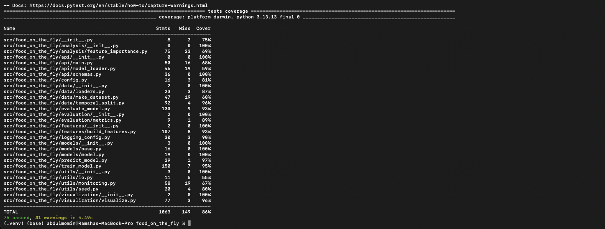
- **Explanation:** There are 75 tests covering data load and the temporal split, the custom feature transformers, training, evaluation and the API, at 86% coverage. The end-to-end test builds a small synthetic dataset and runs the same entry points that CI and Vertex AI run (split, train, evaluate, batch predict) in a temporary folder, so it needs no real data/network. Tests that need the real Zomato data skip themselves when it's not there.

### 1.2 GitHub Actions CI workflow

- **Files:** `.github/workflows/pr-checks.yml`
- **Screenshot:** 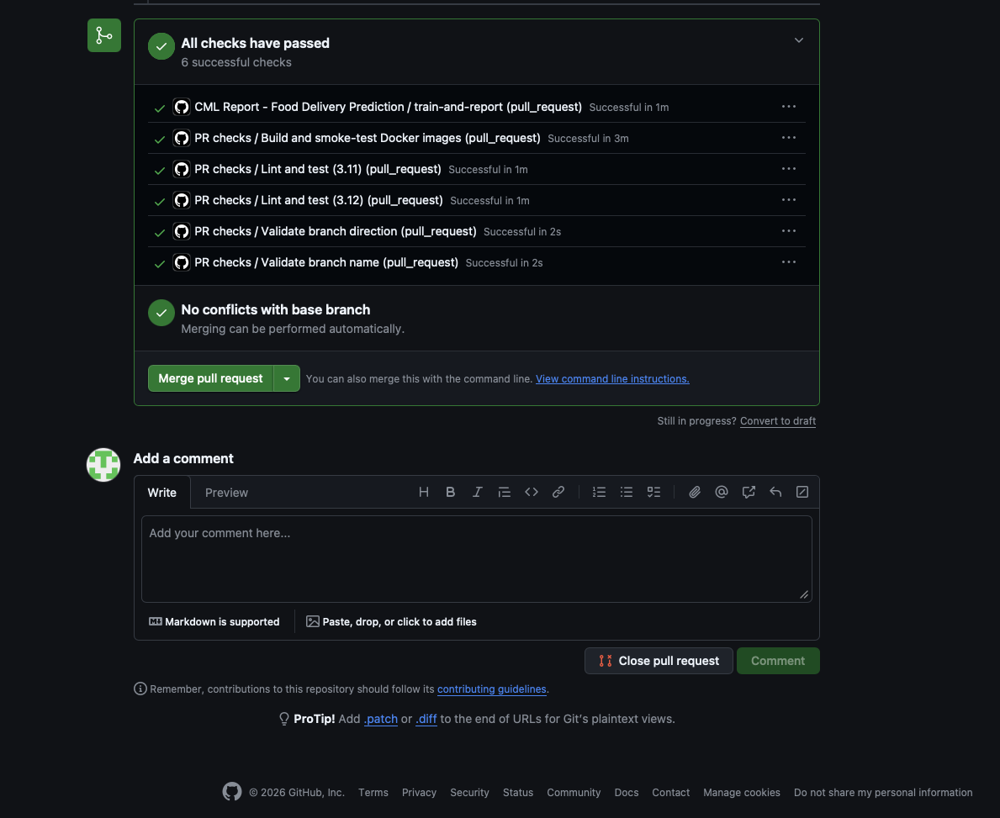
- **Explanation:** Every pull request runs six checks before it can merge: branch name and direction rules, ruff, mypy and pytest on Python 3.11 & 3.12, a Docker build that starts the API container and calls `/health` and `/predict`, and also the CML job. The same checks run again on `main` after a merge, and the Cloud Run deployment only starts if they pass.

### 1.3 Pre-commit hooks

- **Files:** `.pre-commit-config.yaml`; setup steps in `CONTRIBUTING.md` and README "Testing"
- **Screenshot:** 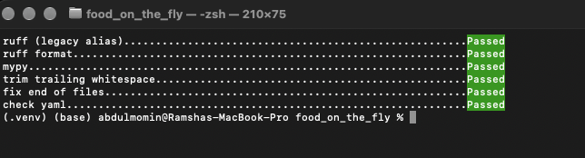
- **Explanation:** Pre-commit runs ruff lint and format, mypy, and whitespace and YAML checks on all local commits, which are the same rules CI enforces. We have to catch them befor a formatting error pops up. Setup is `pre-commit install` and is once per clone.

### 2.1 Automated Docker builds

- **Files:** `.github/workflows/pr-checks.yml` (job `docker-build`, every PR), `.github/workflows/deploy.yml` (build and push on every commit to `main`), `dockerfiles/Dockerfile`, `dockerfiles/Dockerfile.api`
- **Screenshot:** 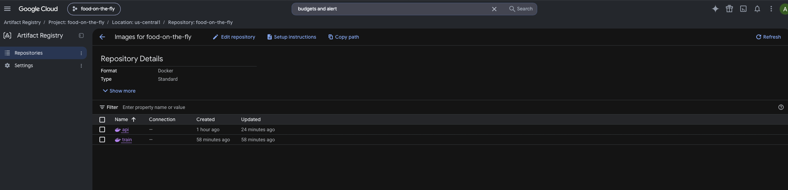
- **Explanation:** Both images are built on every pull request, and the API image is smoke tested before the PR can merge. Every commit that reaches `main` builds the API image again, tags it with the commit SHA reference, pushes it to Artifact Registry and deploys it to Cloud Run. Tagging by SHA means any running version can be traced back to its code and rolled back by redeploying the older tag.

### 2.2 Continuous Machine Learning (CML)

- **Files:** `.github/workflows/cml.yml`, `scripts/compare_to_baseline.py`, `reports/baseline_metrics.json`, `docs/cml.md`
- **Screenshot:** 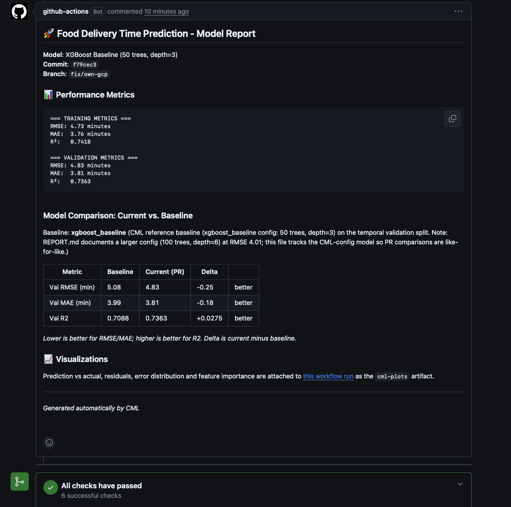
- **Explanation:** CML trains the baseline XGBoost config on Github for every push to a PR and posts the metrics back as a PR comment. The comment compares the PR's model with the stored baseline in `reports/baseline_metrics.json`, so a change that makes the model worse will show up in review. On PR #2 validation RMSE went from 5.08 to 4.83 minutes. The four plots are attached to the run as the `cml-plots` artifacts.

### 3.1 GCP Artifact Registry

- **Files:** `scripts/gcp_setup.sh` (repository, service accounts, Workload Identity Federation), `.github/workflows/deploy.yml`
- **Screenshot:** 
- **Explanation:** One Artifact Registry repository in `us-central1` holds both images: `api` for serving and `train` for Vertex AI. GitHub Actions pushes to it through Workload Identity Federation limited to this repository, so no service account keys exist anywhere. The setup script creates the repository, service accounts, and federation in one run.

### 3.2 Custom training job on GCP (Vertex AI)

- **Files:** `scripts/gcp_extras.sh` (job spec and submission), `scripts/upload_artifacts.py`, `dockerfiles/Dockerfile`, `configs/config.yaml` (`data.source_uri` points at the bucket)
- **Screenshots:** 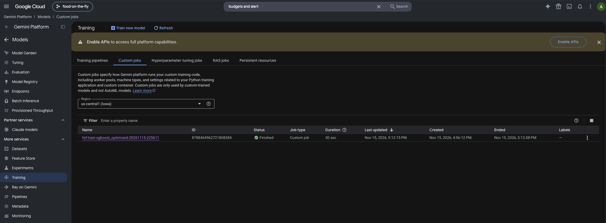 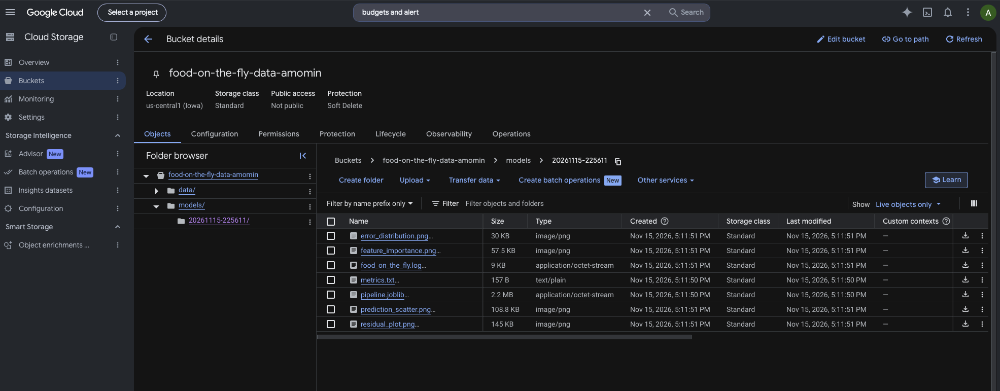
- **Explanation:** The training image runs as a Vertex AI custom job under its own service account. The job reads the raw CSV from the Cloud Storage bucket, runs the temporal split, trains the optimized config and uploads the pipeline, metrics, plots and log to a folder for that run in the same bucket. It reached a validation RMSE of 3.95 minutes, identical to a local run of the same config.

### 3.3 FastAPI + Cloud Functions

- **Files:** `src/food_on_the_fly/api/` (FastAPI app and schemas), `deploy/cloud_function/main.py`
- **Live endpoint:** https://us-central1-food-on-the-fly.cloudfunctions.net/fof-predict (deleted on 2026-11-15 after the demo, see 6.3; the screenshot and sample below are from before the cleanup)
- **Sample:**

  ```bash
  curl -s -X POST https://us-central1-food-on-the-fly.cloudfunctions.net/fof-predict \
    -H "Content-Type: application/json" -d @docs/examples/predict_request.json
  # {"model_version":"pipeline.joblib","predicted_time_min":17.52}
  ```

- **Screenshot:** 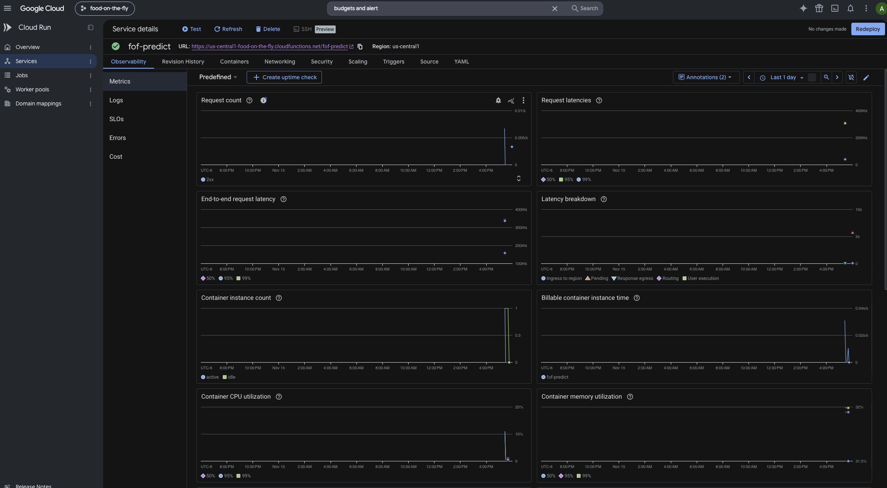
- **Explanation:** The model is also served by a Cloud Function with an HTTP trigger. It reuses the FastAPI service's request schemas and model loader, so the same request body works on both and returns the same prediction (~17.52 minutes for the sample order). This covers the serverless option next to the container one.

### 3.4 Docker container on Cloud Run

- **Files:** `dockerfiles/Dockerfile.api`, `.github/workflows/deploy.yml`, `DEPLOYMENT.md`
- **Live service:** https://food-on-the-fly-api-hhwrf2nw2a-uc.a.run.app (Swagger UI at `/docs`)
- **Sample:**

  ```bash
  curl -s -X POST https://food-on-the-fly-api-hhwrf2nw2a-uc.a.run.app/predict \
    -H "Content-Type: application/json" -d @docs/examples/predict_request.json
  # {"predicted_time_min":17.52,"model_version":"pipeline.joblib"}
  ```

- **Screenshot:** 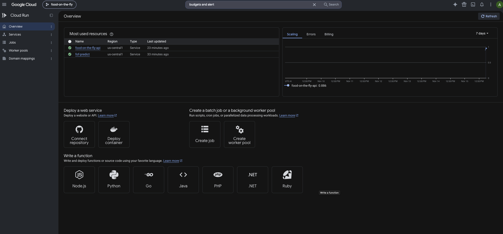
- **Explanation:** The FastAPI container runs on Cloud Run with 1 vCPU, between 0 and 2 instances. Scaling to zero keeps the idle cost at 0, at the price of a cold start of a few seconds on the first request. A load test of 600 requests at 10 per second had a 100% success rate with a p95 latency of 39 ms.

### 4.1 UI on Hugging Face Spaces

- **Files:** `app/index.html` (Space), `app/app.py` (Gradio version for local use), `.github/workflows/deploy-hf.yml`
- **Space:** https://huggingface.co/spaces/amomin1993/food-on-the-fly
- **Screenshot:** 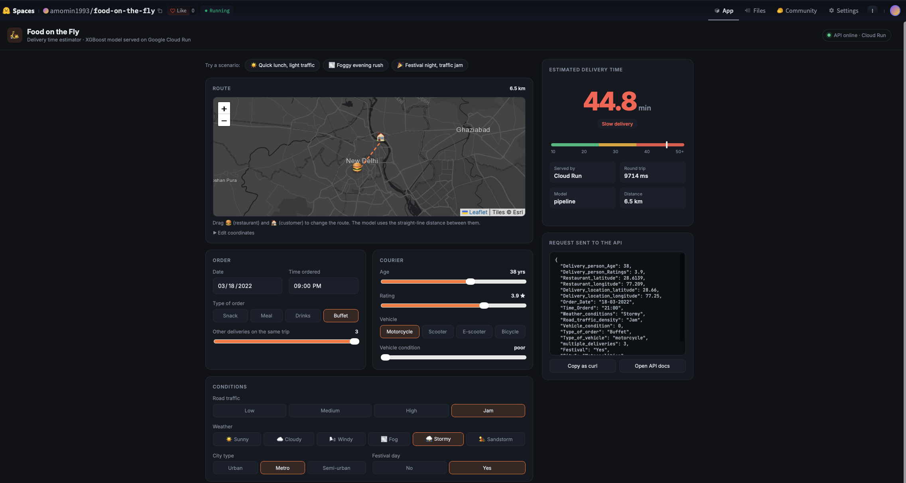
- **Explanation:** The Space is a web page that sends each prediction request to the Cloud Run API, so the model runs in one place for every client. GitHub Actions uploads the app folder to the Space on every push to `main` that changes it. Hugging Face's free tier now only hosts static Spaces (bummer!), so the page is plain HTML... ; the Gradio version in `app/app.py` does the same thing and runs locally. I believe hugging face changed their tiers very recently.

### 5.1 End-to-end demo recording

- **Recording:** embedded at the top of [README.md](README.md#demo-and-live-deployment)

### 6.1 README

- **Files:** `README.md` (demo and live links at the top, section "Phase 3: CI/CD, CML and Cloud Deployment")
- **Screenshot:** 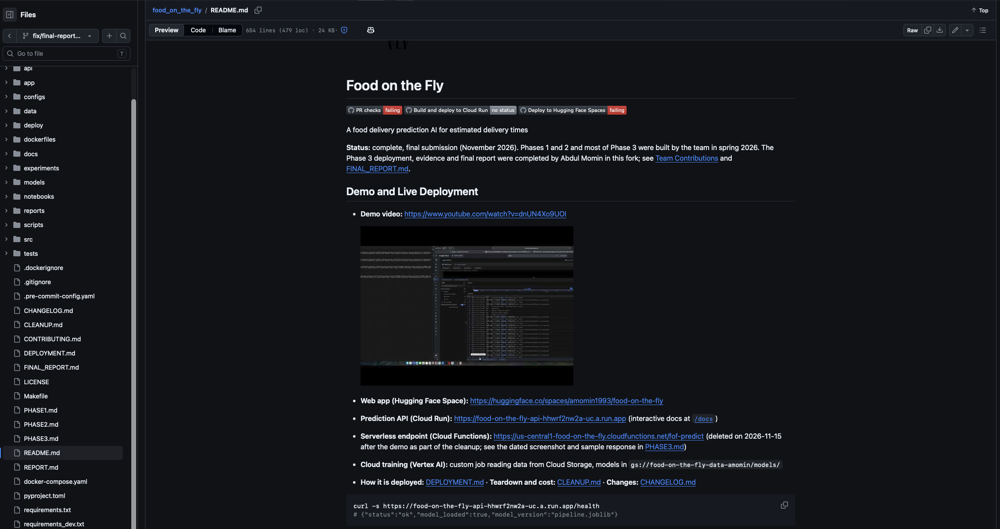
- **Explanation:** The README is the entry point: the demo recording and every live link are at the top, and a Phase 3 section lists each tool and service with the file that implements it. Detailed evidence stays in this file and the how-to in `DEPLOYMENT.md`, so the README stays readable.

### 6.2 PHASE3.md

- This file: every item above and below lists its files and evidence. This was the biggest missing piece in our submissions, finally fixed along with dev --> main.

### 6.3 GCP resource cleanup

- **Files:** `CLEANUP.md`
- **Screenshot:** 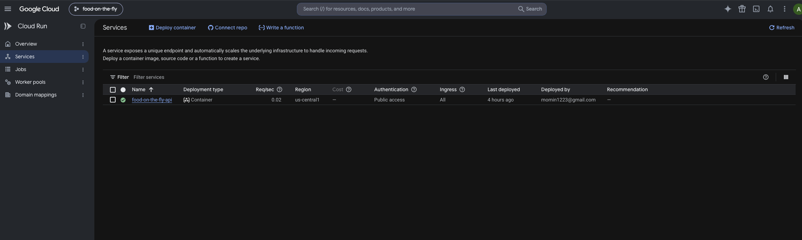
- **Explanation:** After the demo was recorded, the Cloud Function, the training image and older API images were deleted with the commands in `CLEANUP.md`. The Cloud Run service and its current image stay up until grading because the Hugging Face app depends on them, and they cost nothing while idle (i made sure). The full teardown is listed in the same file as well.

### Extra: monitoring

- **Files:** `deploy/monitoring/dashboard.json`, `deploy/monitoring/alert_5xx.json`, `scripts/gcp_monitoring.sh`
- **Screenshots:** 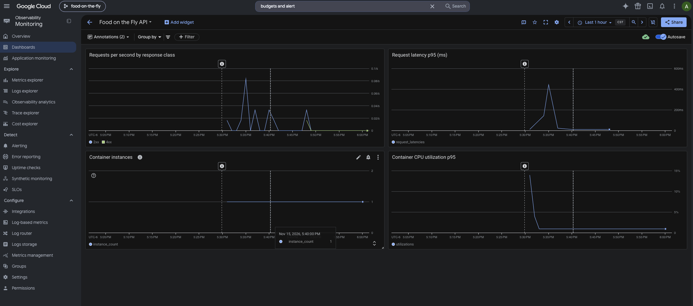 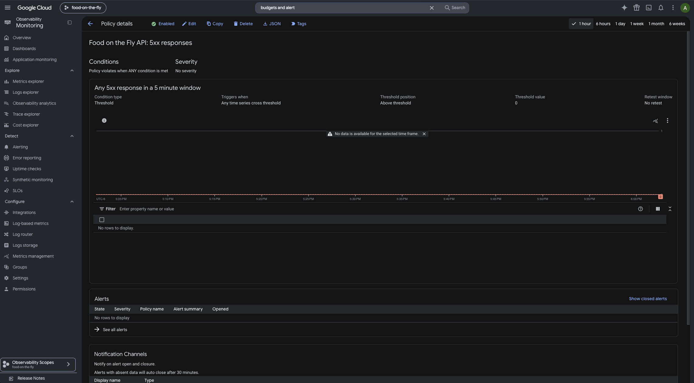
- **Explanation:** The dashboard tracks the Cloud Run service: requests by response class, p95 latency, instance count and CPU. An alert fires on any 5xx response in a five-minute window. It's stored as JSON and created by a script, so they can be rebuilt in a new project.

---

## Detailed checklist

## 1. Continuous Integration & Testing

- [x] **Unit Tests**: Write pytest test scripts for data processing and model components
  - Evidence: `tests/test_features.py` (custom transformers), `tests/test_model.py`, `tests/test_evaluation.py`, `tests/test_temportal_split.py`, `tests/test_data_loaders.py`
- [x] **Integration Tests**: End-to-end checks across components
  - Evidence: `tests/test_training_pipeline.py` (trains the full pipeline on the processed splits), `tests/test_api.py` (FastAPI app through `TestClient`), `tests/test_data_quality.py` (validates the real dataset)
- [x] **Test Coverage**: Aim for >80% code coverage
  - Evidence: 86% line coverage, 75 tests passing (`pytest --cov=src/food_on_the_fly`). `tests/test_end_to_end.py` runs temporal split, training, evaluation and batch prediction on a synthetic dataset, so the training and evaluation entry points are covered without the real data
- [x] **GitHub Actions - Tests**: Create workflow for running tests on every push
  - Evidence: `.github/workflows/pr-checks.yml` job `lint-and-test`
  - [x] Trigger on: PRs into `dev` and `main`, pushes to `main`, manual dispatch
  - [x] Test across multiple Python versions (matrix: 3.11, 3.12)
  - [x] Report coverage metrics (`pytest --cov`, coverage summary step, `coverage.xml` uploaded to Codecov)
- [x] **GitHub Actions - Code Quality**: Create workflow for:
  - [x] Running ruff linter (`ruff check .`)
  - [x] Type checking with mypy (`mypy src`)
  - [x] Formatting checks (`ruff format --check .`)
  - Evidence: `.github/workflows/pr-checks.yml` job `lint-and-test`, plus branch naming and direction rules (jobs `validate-branch-name`, `validate-branch-direction`)
- [x] **GitHub Actions - Docker Build**: Create workflow for building Docker image
  - [x] Build on PR and main branch push
  - [x] Test built image (container started, `/health` must report a loaded model, `/predict` must return a delivery time between 0 and 120 minutes)
  - Evidence: `.github/workflows/pr-checks.yml` job `docker-build`
- [x] **Pre-commit Hooks**: Set up pre-commit hooks for:
  - [x] Formatting (`ruff-format`)
  - [x] Linting (`ruff --fix`)
  - [x] Type checking (`mypy`)
  - [x] Trailing whitespace (`trailing-whitespace`, `end-of-file-fixer`, `check-yaml`)
  - Evidence: `.pre-commit-config.yaml`
- [x] **Test Documentation**: Document how to run tests locally and in CI
  - Evidence: `README.md` section "Testing"

---

## 2. Continuous Docker Building & CML

- [x] **Automated Docker Builds**: Configure Docker build pipeline triggered by:
  - [x] Commits to main branch (`workflow_run` after "PR checks" succeeds on `main`)
  - [x] Version tags (`v*.*.*`)
  - [x] Manual workflow dispatch
  - Evidence: `.github/workflows/deploy.yml` (builds `dockerfiles/Dockerfile.api`, tags with the commit SHA, deploys with 0-2 instances). Runs: [deploy.yml on GitHub Actions](https://github.com/amomin1993/food_on_the_fly/actions/workflows/deploy.yml) (one per merge to `main`)
- [x] **Docker Push**: Implement push to container registry
  - Evidence: Artifact Registry `us-central1-docker.pkg.dev/food-on-the-fly/food-on-the-fly/api`, first image `api:aeffe21` (`sha256:1242ad57…`) pushed by `scripts/gcp_setup.sh`; `deploy.yml` pushes `api:<commit sha>` on every deploy
- [x] **CML Initialization**: Initialize CML in repository
  - Evidence: `.github/workflows/cml.yml` (`iterative/setup-cml@v2`)
- [x] **CML Workflow**: Create GitHub Actions workflow for CML that:
  - [x] Trains model on workflow runner (`model=xgboost_baseline` for speed)
  - [x] Generates performance metrics (RMSE, MAE, R² written to `metrics.txt`)
  - [x] Creates visualizations/plots (prediction scatter, residuals, error distribution, feature importance)
  - [x] Comments results on PR (`cml comment create report.md`; the four plots are attached to the run as the `cml-plots` artifact)
  - Evidence: [PR #2](https://github.com/amomin1993/food_on_the_fly/pull/2) (`fix/own-gcp` into `dev`) received one report per push. Latest: validation RMSE 4.83 min vs baseline 5.08, MAE 3.81 vs 3.99, R² 0.736 vs 0.709. Screenshots: `docs/images/phase3/cml_pr_comment.png`, `docs/images/phase3/ci_checks_green.png` (all six checks green)
- [x] **CML Metrics Output**: Document format and sample output of CML metrics
  - Evidence: `docs/cml.md` section "Metrics format". Sample `metrics.txt` from the baseline config:

    ```
    === TRAINING METRICS ===
    RMSE: 4.94 minutes
    MAE: 3.91 minutes
    R²: 0.7180

    === VALIDATION METRICS ===
    RMSE: 5.09 minutes
    MAE: 4.00 minutes
    R²: 0.7073
    ```

- [x] **CML Plots**: Generate sample plots and document in CML workflow
  - Evidence: `train_model.py` CML section writes `prediction_scatter.png`, `residual_plot.png`, `error_distribution.png`, `feature_importance.png`; documented in `docs/cml.md` "Plots"
- [x] **Model Comparison**: Create CML output showing comparison of current vs. baseline model
  - Evidence: `scripts/compare_to_baseline.py` diffs the PR's metrics against `reports/baseline_metrics.json` and writes a Markdown table (current, baseline, delta, better/worse per metric) that the CML step appends to the PR comment
- [x] **Workflow Documentation**: Document CML workflow setup and customization
  - Evidence: `docs/cml.md` (triggers, prerequisites, secrets, pipeline steps, metrics format, plots, baseline comparison, customization, troubleshooting)

---

## 3. Deployment on GCP

- [x] **GCP Project Setup**: Create GCP project and enable necessary APIs
  - Evidence: project `food-on-the-fly` with a $10 budget alert; `scripts/gcp_setup.sh` enables Cloud Run, Artifact Registry, Cloud Build, IAM Credentials, STS, Logging, Monitoring and Storage. Steps in `DEPLOYMENT.md` section 1
- [x] **Service Account**: Create service account with appropriate permissions for:
  - [x] Artifact Registry (`github-deployer`: `roles/artifactregistry.writer`)
  - [x] Vertex AI (`fof-trainer`: `roles/storage.objectAdmin` on the bucket, `roles/logging.logWriter`; the training job runs as this account)
  - [x] Cloud Run (`github-deployer`: `roles/run.admin` + `serviceAccountUser` on `fof-api-runtime`; `fof-api-runtime` runs the service with no roles)
  - [x] Cloud Functions (`fof-builder`: `roles/cloudbuild.builds.builder` for the function build; the function runs as `fof-api-runtime`)
  - [ ] Compute Engine (not used: training runs on Vertex AI instead)
  - Evidence: `scripts/gcp_setup.sh`, `scripts/gcp_extras.sh`; GitHub Actions authenticates through Workload Identity Federation (pool `github`, provider `github-oidc`, limited to this repository), so no service account keys exist
- [x] **Artifact Registry**: Set up Artifact Registry for storing Docker images
  - [x] Create repository in Artifact Registry (`food-on-the-fly`, `us-central1`)
  - [x] Configure authentication from CI/CD (Workload Identity Federation, secrets listed in `DEPLOYMENT.md` section 2)
  - [x] Push Docker images to registry (`api:<commit sha>` for serving, `train:<commit sha>` for Vertex AI)
  - Screenshot: `docs/images/phase3/artifact_registry.png`
- [x] **Vertex AI Training (Option A)**: Set up custom training on Vertex AI
  - [x] Create training container image (`dockerfiles/Dockerfile`, pushed as `train:20a3dd6`)
  - [x] Configure training job specification (`scripts/gcp_extras.sh`: one `n1-standard-4` worker reads the raw CSV from `gs://food-on-the-fly-data-amomin/data/raw/`, runs the temporal split, trains `model=xgboost_optimized`, uploads artifacts with `scripts/upload_artifacts.py`)
  - [x] Document how to submit training jobs (`DEPLOYMENT.md` section 10)
  - Evidence: custom job `8788464962721808384` (`JOB_STATE_SUCCEEDED`, 2026-11-15). Validation RMSE 3.95 min, MAE 3.12 min, R² 0.823. Screenshot: `docs/images/phase3/vertex_job.png`
- [ ] **Compute Engine Training (Option B)**: Set up training on Compute Engine instance
  - [ ] Create VM instance with GPU if needed
  - [ ] Document SSH access and training process
  - [ ] Set up instance for automated training
- [x] **Model Registry**: Store trained models in GCS bucket with versioning
  - [x] Create GCS bucket for models (`gs://food-on-the-fly-data-amomin/models/`, one folder per training run named by its UTC timestamp)
  - [x] Implement model upload from training (`scripts/upload_artifacts.py`: `pipeline.joblib`, `metrics.txt`, four plots, training log)
  - [x] Document model retrieval process (`DEPLOYMENT.md` section 10)
  - Evidence: `gs://food-on-the-fly-data-amomin/models/20261115-225611/`. Screenshot: `docs/images/phase3/vertex_artifacts.png`
- [x] **FastAPI Service**: Create FastAPI application for model serving
  - [x] Define inference endpoint(s) (`POST /predict`, `POST /predict/batch`)
  - [x] Implement request validation (Pydantic schemas in `api/schemas.py`, 422 on missing or mistyped fields, batch requires at least one item)
  - [x] Add health check endpoint (`GET /health` reports `model_loaded` and `model_version`)
  - [x] Document API specification (`docs/http_api.md`, Swagger UI at `/docs`)
  - Evidence: `src/food_on_the_fly/api/main.py`, `api/model_loader.py`, `api/schemas.py`, `tests/test_api.py`
- [x] **Cloud Functions Deployment (Option A)**: Deploy inference as Cloud Function
  - [x] Package model and app code for Cloud Functions (`deploy/cloud_function/main.py` reuses the API's Pydantic schemas and model loader; `pipeline.joblib` is bundled with the source)
  - [x] Create Cloud Function with appropriate memory/timeout (`fof-predict`, gen2, Python 3.11, 1 GiB, 60 s, max 2 instances)
  - [x] Configure HTTP trigger: **https://us-central1-food-on-the-fly.cloudfunctions.net/fof-predict** (`GET` health, `POST` one order or `{"instances": [...]}`)
  - [x] Document invocation and response format (`DEPLOYMENT.md` section 10)
  - Evidence: smoke test returned `{"model_loaded":true,...,"runtime":"cloud-functions"}` and `{"predicted_time_min":17.52}`, matching Cloud Run. Screenshot: `docs/images/phase3/cloud_function.png`
- [x] **Cloud Run Deployment (Option B)**: Deploy as containerized service on Cloud Run
  - [x] Create Dockerfile optimized for Cloud Run (`dockerfiles/Dockerfile.api`: two-stage `python:3.11-slim-bookworm`, honours `PORT`, model baked in via `MODEL_PATH`)
  - [ ] Test locally with Cloud Run emulator (not used; the same image is run locally and smoke-tested in the CI `docker-build` job instead)
  - [x] Deploy to Cloud Run with auto-scaling (`food-on-the-fly-api`, 0-2 instances, 1 vCPU, 1 GiB): **https://food-on-the-fly-api-hhwrf2nw2a-uc.a.run.app**
  - [x] Document deployment process (`DEPLOYMENT.md`)
  - Screenshot: `docs/images/phase3/cloud_run_service.png`
- [x] **Streamlit/Gradio Deployment (Option C)**: Deploy demo app on HuggingFace Spaces
  - [x] Create Streamlit or Gradio interface for model (`app/app.py` Gradio app for local use; `app/index.html` for the Space, because Hugging Face's free tier now only hosts static Spaces)
  - [x] Push to GitHub repository
  - [x] Deploy to HuggingFace Spaces: **https://huggingface.co/spaces/amomin1993/food-on-the-fly**, published by `.github/workflows/deploy-hf.yml`. The page sends each request to the Cloud Run API (CORS allows `*.hf.space`)
  - [x] Document feature walkthrough (`DEPLOYMENT.md` section 10)
  - Screenshot: `docs/images/phase3/hf_space.png`
- [x] **Load Testing**: Test deployment with load testing tool (locust, Apache JMeter)
  - [x] Establish baseline performance metrics (600 requests at 10 req/s against Cloud Run: 100% success, p50 32.4 ms, p95 38.7 ms, p99 50.5 ms)
  - [x] Document scaling characteristics (`DEPLOYMENT.md` section 7: one instance absorbs 10 req/s; cold start after scale-to-zero; max 2 instances)
  - Evidence: `scripts/load_test.py` (async httpx, randomized orders), raw output in `docs/logs/load_test_cloud_run.txt`
- [x] **Monitoring Setup**: Configure Cloud Monitoring and Cloud Logging
  - [x] Set up log aggregation (API logs to stdout, collected by Cloud Logging; query in `DEPLOYMENT.md` section 8)
  - [x] Create monitoring dashboards (`deploy/monitoring/dashboard.json`: requests by response class, p95 latency, instance count, CPU; created by `scripts/gcp_monitoring.sh`). Screenshot: `docs/images/phase3/monitoring_dashboard.png`
  - [x] Set up alerts for anomalies (`deploy/monitoring/alert_5xx.json`: any 5xx responses over 5 minutes). Screenshot: `docs/images/phase3/alert_policy.png`

---

## 4. Documentation & Repository Updates

- [x] **Comprehensive README**: Update README with:
  - [x] Architecture diagram showing all components (`README.md` "Architecture Diagram", full set in `docs/architecture.md`)
  - [x] CI/CD pipeline overview (`docs/architecture.md` "CI/CD")
  - [x] Deployment instructions for each option (`DEPLOYMENT.md`: Cloud Run sections 3-4; Vertex AI, Cloud Functions and Hugging Face section 10)
  - [x] GCP setup and configuration guide (`DEPLOYMENT.md` sections 1-2)
  - [x] How to invoke deployed models (`DEPLOYMENT.md` section 5, `docs/http_api.md`)
  - [x] Monitoring and troubleshooting guide (`DEPLOYMENT.md` sections 8 and 11, README "Troubleshooting")
  - [x] Cost estimation and optimization tips (`CLEANUP.md` "What exists and what it costs" and "Cost monitoring")
- [x] **Deployment Guide**: Create detailed DEPLOYMENT.md with:
  - [x] Step-by-step GCP setup instructions (section 1)
  - [x] Cloud Run deployment procedure (sections 3-4)
  - [x] Cloud Functions configuration (section 10)
  - [x] Environment variables and secrets management (sections 2 and 6)
  - [x] Rollback procedures (section 9)
- [x] **API Documentation**: Document all endpoints with:
  - [x] Request/response schemas
  - [x] Example curl/Python requests
  - [x] Error codes and messages
  - Evidence: `docs/http_api.md`
- [x] **Architecture Documentation**: Include diagrams showing:
  - [x] Data pipeline
  - [x] Training pipeline
  - [x] Inference/serving architecture
  - [x] CI/CD workflow
  - Evidence: `docs/architecture.md`
- [x] **Screenshots/Demos**: Add (all in `docs/images/phase3/`, shown with explanations in the summary at the top of this file):
  - [x] Cloud Run dashboard screenshot (`cloud_run_service.png`)
  - [x] Monitoring dashboard screenshot (`monitoring_dashboard.png`)
  - [x] Streamlit/Gradio app screenshot (`hf_space.png`)
  - [x] API response example (`docs/http_api.md`, `docs/logs/sample_inference.log`, request panel in `hf_space.png`)
  - [x] CML workflow output sample (`cml_pr_comment.png`)
  - Demo recording: embedded at the top of [README.md](README.md#demo-and-live-deployment)
- [x] **Troubleshooting Guide**: Document solutions for:
  - [x] Common deployment errors (`DEPLOYMENT.md` section 11: arm64 images, 503 with no model)
  - [x] Authentication issues (WIF `getAccessToken` denied, `allUsers` blocked by org policy)
  - [x] Performance problems (cold starts, instance limits: `DEPLOYMENT.md` section 7)
  - [x] Cost overruns (`CLEANUP.md` "Cost monitoring", budget alert)
- [x] **Resource Cleanup Reminder**: Create CLEANUP.md with instructions for:
  - [x] Deleting GCP resources (project deletion, or service, registry, service accounts and WIF pool one by one)
  - [x] Cleaning up Cloud Storage buckets
  - [x] Disabling APIs to avoid charges
  - [x] Cost monitoring recommendations
- [x] **Contributing Guide Update**: Update CONTRIBUTING.md with:
  - [x] CI/CD requirements
  - [x] Testing requirements for PRs
  - [x] Deployment process documentation
  - Evidence: `CONTRIBUTING.md` section "How CI/CD works" (all three workflows, PR testing requirements, deploy sequence)
- [x] **Changelog**: Maintain CHANGELOG.md documenting releases and deployments
  - Evidence: `CHANGELOG.md`

---

> **Checklist:** Use this as a guide for documenting your Phase 3 deliverables.
