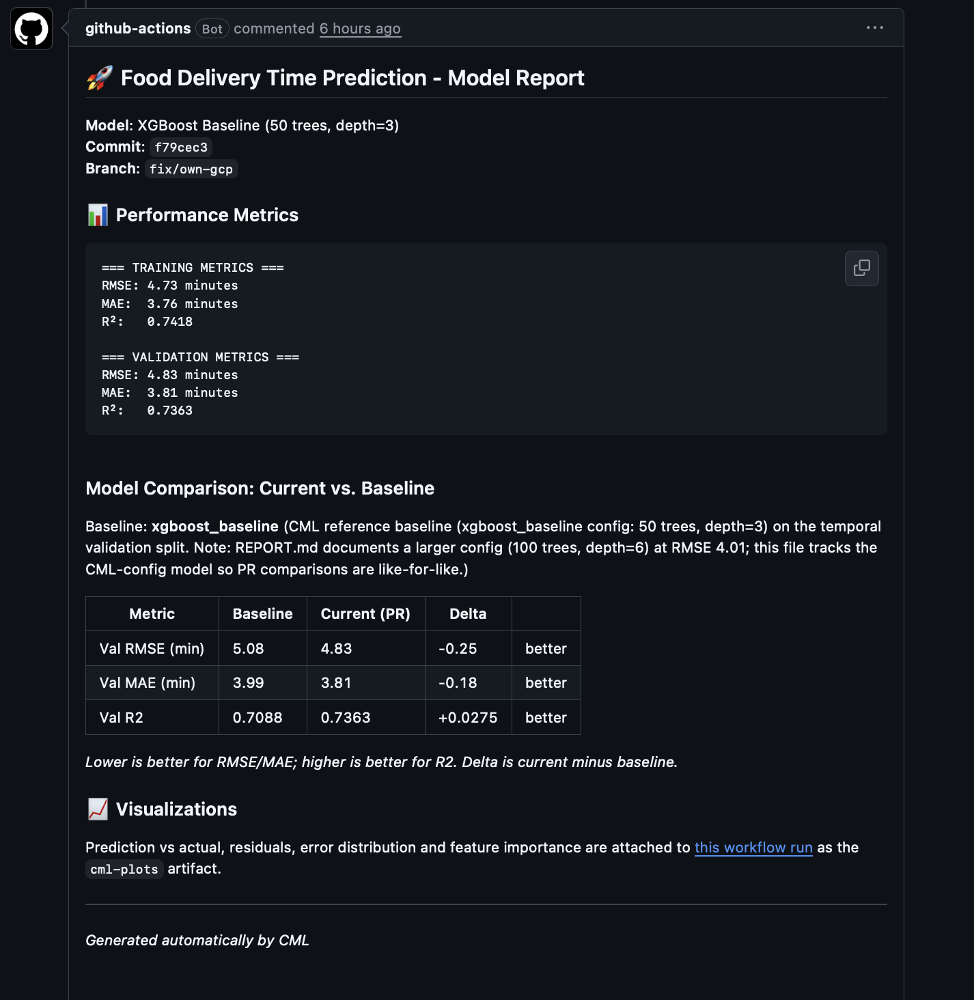
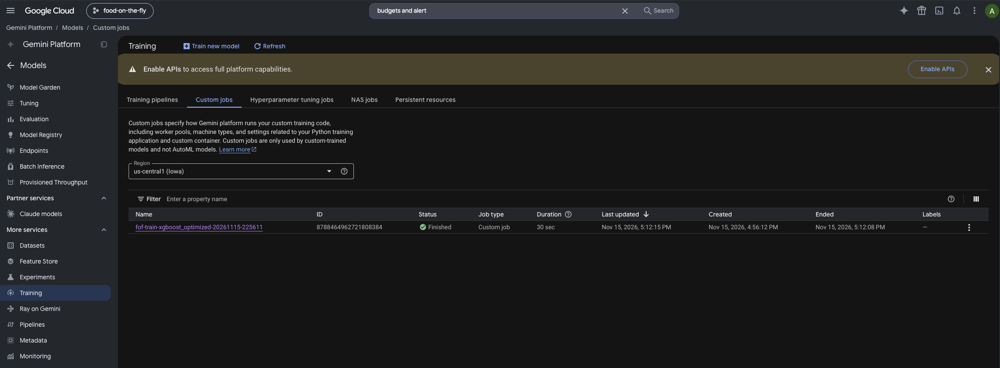
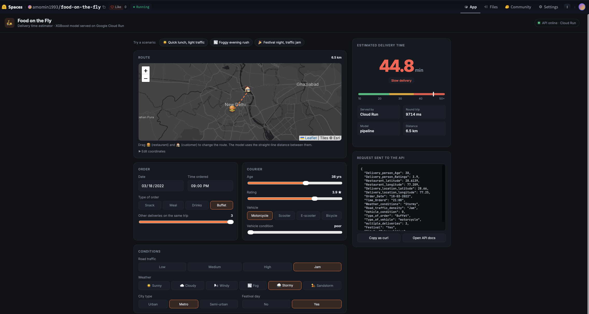
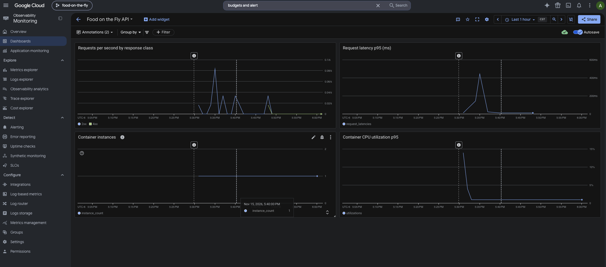

# Food on the Fly: Phase 3 Report

**Course:** SE 489 Machine Learning Engineering for Production (MLOps), DePaul University

**Author:** Abdul Momin (Modeling Lead)

**Repository:** https://github.com/amomin1993/food_on_the_fly

**Live app:** https://huggingface.co/spaces/amomin1993/food-on-the-fly

**Demo video:** https://www.youtube.com/watch?v=dnUN4Xo9UOI

**Checklist with evidence:** [PHASE3.md](PHASE3.md)

**Other reports:** [Phase 1](REPORT_PHASE1.md) and [Phase 2](REPORT_PHASE2.md)

**Team (Spring 2026):** Jose Muniz (project lead, platform), Aviv Katz (training pipeline, CML, Docker), Imran Ahmed (data, tests, load testing, UI), Abdul Momin (modeling, profiling, CML comparison)

This is the Phase 3 report. It covers continuous integration, CML, cloud training, serving, the user interface, monitoring and cleanup. Phase 3 was graded in the spring on the team's dev branch as of June 8 (commit [0abb8cc](https://github.com/josemunizdev/food_on_the_fly/commit/0abb8cc)). By then the team had CI, the CML workflow, the FastAPI service and a deploy workflow. The problem was that main was still stuck at Phase 2, the deployment depended on a teammate's GCP project, and most of 'PHASE3.md' was still the empty template. I did the rest on my own in November. Section 4 lists what I added and section 6 matches it against the grading feedback.

---

## 1. What was built

**Continuous integration.**

'.github/workflows/pr-checks.yml' runs on every PR into dev or main and on every push to main:

1. Validates the branch name and direction
2. Runs ruff lint, ruff format check, mypy and pytest with coverage on Python 3.11 and 3.12
3. Builds both Docker images, starts the API container, and fails unless '/health' reports a loaded model and '/predict' returns a delivery time between 0 and 120 minutes

The same ruff, mypy and whitespace checks also run locally through pre-commit.

There are 75 tests at 86% line coverage. Most of the coverage on training and evaluation comes from one end-to-end test. It builds a small synthetic dataset with the same columns as Zomato, then runs the temporal split, training, evaluation in all three selection modes, batch prediction and the feature importance report in a temporary folder. It needs no real data or network, so it runs in CI on every PR. Before it was added, coverage was 34% because those modules only ran when the real dataset was present.

**CML.**

'.github/workflows/cml.yml' trains the baseline config on the GitHub runner for every PR, writes 'metrics.txt' and four plots (predicted vs actual, residuals, error distribution, feature importance), and posts the results as a PR comment. I added the comparison step: 'scripts/compare_to_baseline.py' reads the PR's metrics, compares them against 'reports/baseline_metrics.json', and adds a table showing the change and whether each metric got better or worse. That way a reviewer can see in the PR itself whether a change helped the model. 'docs/cml.md' documents setup and customization.

On PR #2 the report showed:

1. Validation RMSE 4.83 against the stored baseline of 5.08
2. MAE 3.81 against 3.99
3. R² 0.736 against 0.709

So the feature work since the baseline was recorded improved every metric. During this run CML's own image host started returning server errors, which failed the job, so the plots are now attached to the workflow run as a downloadable artifact and the comment links to it.

*Figure 1: The report CML posted on PR #2, with the comparison against the stored baseline.*

**Serving.**

The FastAPI app exposes 'GET /health', 'POST /predict' and 'POST /predict/batch'. Request bodies are Pydantic models whose field names match the raw dataset columns, so a payload turns straight into a DataFrame for the pipeline.

1. Missing or mistyped fields return 422.
2. A pipeline failure returns 400 with the reason.
3. If no model can load, the service still starts, '/health' reports 'model_loaded: false' and '/predict' returns 503. This makes a bad deploy visible instead of crash-looping.

The full reference with real responses is in 'docs/http_api.md'.

**Deployment on GCP.**

Everything runs in my own project, 'food-on-the-fly', in 'us-central1', with a $10 budget alert. One script, 'scripts/gcp_setup.sh', creates the Artifact Registry repository, the data bucket, the service accounts and Workload Identity Federation for GitHub Actions, so the workflows sign in to Google Cloud without any stored key. Each merge to main builds the API image, tags it with the commit SHA, pushes it to Artifact Registry and deploys it to Cloud Run (1 vCPU, 1 GiB, 0 to 2 instances, so it costs nothing when idle).

A second script, 'scripts/gcp_extras.sh', covers the rest of Phase 3:

1. **Vertex AI training.** The training image runs as a custom job on one 'n1-standard-4' machine under its own service account. It reads the raw CSV from the bucket, trains the optimized config and writes the pipeline, metrics, plots and log to a folder for that run in the same bucket. The first run succeeded and matched the training and validation numbers of the optimized config in the [Phase 2 report](REPORT_PHASE2.md).
2. **Cloud Function.** The same model is deployed as a gen2 Cloud Function with an HTTP trigger. It reuses the API's request schemas and model loader, so the same request works on both endpoints and returns the same prediction (17.52 minutes for the sample order).
3. **Hugging Face Space.** The user-facing app is a web page on Hugging Face that sends each request to the Cloud Run API. You pick a scenario or drag the restaurant and customer pins on a map, set the order details, and the page shows the estimate, a fast, typical or slow label, the round-trip time and the exact JSON that was sent. Hugging Face's free tier only hosts static pages now, so the Space is plain HTML and the API allows requests from 'hf.space'. The Gradio version in 'app/app.py' does the same thing locally. A GitHub Action republishes the Space on every push to main that changes the app.

*Figure 2: The Vertex AI training job, finished successfully.*

*Figure 3: The Hugging Face app on a festival night scenario, with the prediction served by the Cloud Run API.*

**Load test.**

'scripts/load_test.py' sent 600 randomized orders at 10 requests per second for one minute to the live Cloud Run service:

1. All 600 succeeded
2. Median latency 32 ms, p95 39 ms, p99 51 ms
3. One instance handled the whole load

The only slow requests are cold starts after the service has scaled to zero, which took 10 to 16 seconds when I checked. For a real delivery app I would keep one instance warm.

**Monitoring.**

API logs go to stdout and are collected by Cloud Logging. A Cloud Monitoring dashboard, defined as JSON in 'deploy/monitoring/', shows requests by response class, p95 latency, instance count and CPU. An alert policy fires on any 5xx response in a five-minute window. 4xx responses are left out because they come from bad input, not a broken service.

*Figure 4: The Cloud Monitoring dashboard for the API: requests by response class, p95 latency, instances and CPU.*

**Cleanup.**

'CLEANUP.md' lists every resource, what it costs when idle, and how to delete it. The Cloud Function and unused images were removed after the demo was recorded. The Cloud Run service is kept running until grading because the Hugging Face app depends on it, and it costs nothing while idle. The full teardown commands are in the same file.

## 2. My contribution in the spring

1. [PR #53](https://github.com/josemunizdev/food_on_the_fly/pull/53) (June 7): the current vs baseline comparison in the CML report. 'scripts/compare_to_baseline.py' reads the PR's metrics, compares them with 'reports/baseline_metrics.json' and adds the table to the PR comment.
2. [PR #56](https://github.com/josemunizdev/food_on_the_fly/pull/56) (June 7): 'docs/cml.md', the setup and customization guide for the CML workflow.

I also opened PR #57 to update my items in 'PHASE3.md', but it was closed without merging.

## 3. What my teammates had built by June 8

To be clear about what is theirs and not mine:

1. CI with ruff, mypy, pytest and the branch rules (Jose, #23)
2. The CML workflow that trains on the runner and posts metrics and plots (Aviv, #44)
3. The FastAPI service with '/health', '/predict' and '/predict/batch', and its Dockerfile (Jose, #48)
4. The Cloud Run deploy workflow and its version tag trigger (Jose and Aviv, #46 and #48)
5. The load test script (Imran, #55), the Gradio app and the Hugging Face deploy workflow (Imran, #59) and the drift simulation (Imran, #60)

## 4. What I added in November

1. **Main was behind.** Phase 3 work only existed on dev. Everything now goes through pull requests into dev and then main (PRs #1 to #8 in this fork), main holds the final state, and the stale branches are gone.
2. **CI was red.** A newer ruff release started formatting code blocks inside Markdown, so the format check failed on four docs files nobody had touched. Fixed by formatting them.
3. **CI additions.** A new 'docker-build' job builds both images, starts the API container and calls '/health' and '/predict'. I also added Python 3.12 to the test matrix.
4. **Tests.** The end-to-end test on synthetic data plus the CORS tests took coverage from 34% to 86% (75 tests).
5. **The deployed API could not serve predictions.** The API image fell back to an MLflow registry URI that did not exist in the cloud, so '/predict' would always return 503. The image now sets 'MODEL_PATH' to the committed pipeline.
6. **My own GCP project.** 'scripts/gcp_setup.sh' creates the Artifact Registry repository, the bucket, the service accounts and Workload Identity Federation. Now every merge to main deploys to Cloud Run from GitHub Actions, without any stored key.
7. **Vertex AI training.** 'scripts/gcp_extras.sh' and 'scripts/upload_artifacts.py'.
8. **Cloud Function.** 'deploy/cloud_function/', it uses the same schemas and model loader as the API.
9. **Hugging Face Space.** 'app/index.html' calls the Cloud Run API, the API allows requests from 'hf.space', and the Space URL is finally in the README. I also changed the Gradio app so it can call the API.
10. **Monitoring and load test.** The dashboard and the 5xx alert are in 'deploy/monitoring/', and I ran the load test against the live service.
11. **CML.** CML's image host started failing, so now the plots are attached to the workflow run and the comment links to them.
12. **Documentation and evidence.** 'DEPLOYMENT.md', 'CLEANUP.md', 'CHANGELOG.md', 'docs/http_api.md' and 'docs/architecture.md' are all new. 'PHASE3.md' went from 15 of 129 items checked to 123, with 14 screenshots in 'docs/images/phase3/'.
13. **Demo recording.** It is at the top of the README.
14. **Cleanup.** I deleted the Cloud Function and the unused images after the demo, and kept a screenshot of the console.

Three template items are explained in 'PHASE3.md' and not done exactly as written:

1. CI does not run 'dvc pull', the data comes from the Cloud Storage bucket instead
2. Images go to Artifact Registry and not Docker Hub
3. The Space is a static page that calls the API, because the free tier on Hugging Face no longer hosts Gradio Spaces

## 5. Spring submission and this repository side by side

The spring version is the dev branch of the team repo at commit 0abb8cc. [This comparison](https://github.com/josemunizdev/food_on_the_fly/compare/dev...amomin1993:food_on_the_fly:main) shows everything added since then, which is 12 commits and 82 changed files (all mine).

| Item | Spring submission (dev, June 8) | This repository (main) |
| --- | --- | --- |
| main branch | Phase 2 era, last commit May 21 | Up to date, identical to dev, all checks passing |
| 'PHASE3.md' | 15 of 129 items checked, placeholder evidence | 123 of 129 checked, file references and 14 screenshots |
| Demo recording | None | Linked and embedded at the top of the README |
| Cloud Run | Deploy workflow tied to a teammate's GCP project | Live service in my own project, deployed by GitHub Actions on every merge to main |
| Vertex AI training | None | Custom job, artifacts in Cloud Storage |
| Cloud Function | None | Deployed, shown in the demo, then deleted in the cleanup (screenshot kept) |
| Hugging Face Space | Deploy workflow, no Space URL | Space live, URL in the README |
| Monitoring | None | Dashboard and 5xx alert |
| 'DEPLOYMENT.md' and 'CLEANUP.md' | None | Both, plus the cleanup screenshot |
| Test coverage | 34% | 86%, 75 tests |
| Branches | 'feature/phase3_docker_building' unmerged | Only main and dev |

## 6. Phase 3 feedback, item by item

These are the feedback items that could be fixed in the repo:

| Feedback | Where it stands |
| --- | --- |
| Main branch broken, stuck at Phase 2 | main is up to date and identical to dev, with all checks passing |
| Phase 3 work only on dev, 'feature/phase3_docker_building' unmerged | Everything is merged through pull requests. That branch's CML work had reached dev through PR #44, and the branch is deleted in this fork |
| No demo recording | Linked and embedded at the top of the README |
| 'PHASE3.md' largely the unfilled template | 123 of 129 items checked. The 6 left are options we did not use (Compute Engine, the Cloud Run emulator) and say so |
| Placeholder evidence ('link-to-pr', '[PROJECT_ID]', missing screenshots) | Real links, file references and 14 screenshots in 'docs/images/phase3/' |
| No cleanup screenshot, no 'CLEANUP.md' | 'CLEANUP.md' and 'docs/images/phase3/gcp_cleanup.png' |
| No Hugging Face Space URL | https://huggingface.co/spaces/amomin1993/food-on-the-fly, in the README and in 'PHASE3.md' |
| Contribution checkboxes unchecked, TBD rows in the table | Filled in, see the [README](README.md#my-contributions-abdul-momin) |
| 'training:' block still in the model configs | Removed |

## 7. Reflection

The biggest lesson was that an MLOps project fails quietly! Nothing crashed when the optimization was reverted, when the API image pointed at a model that did not exist, or when the format check broke. Each one only showed up because something downstream checked for it: a profile, a health endpoint, a red CI run. That is the case for putting checks in the pipeline instead of trusting that code which worked once still works.

The second lesson is about documentation. A checklist ticked without evidence is worse than one left blank, because the next person trusts it. Rewriting the phase documents so every claim points at a file or a run took longer than some of the code changes, and it found real bugs along the way.

The third is that cloud services change under you. In one evening I ran into three of these:

1. CML's image host started failing
2. Gradio Spaces on Hugging Face turned out to need a paid plan
3. The map tiles I had planned to use needed an API key

None of these were bugs in our code, and each needed a small, documented workaround.

If I kept going, the next steps would be:

1. Serve the optimized model that Vertex AI already trained instead of the baseline one, which would cut prediction error by almost a minute
2. Set a business threshold for "good enough" (for example 90% of predictions within 5 minutes) so tuning has a target
3. Wire the weekly drift windows into a scheduled job that retrains and opens a PR when error on the newest week crosses that threshold
