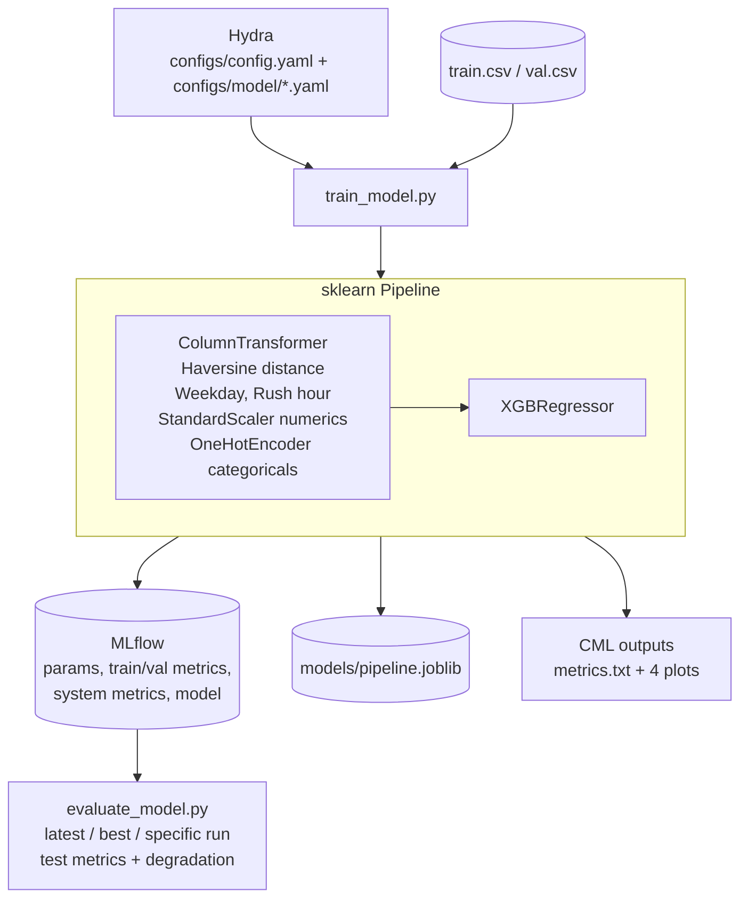
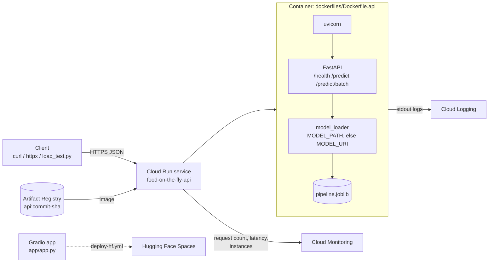
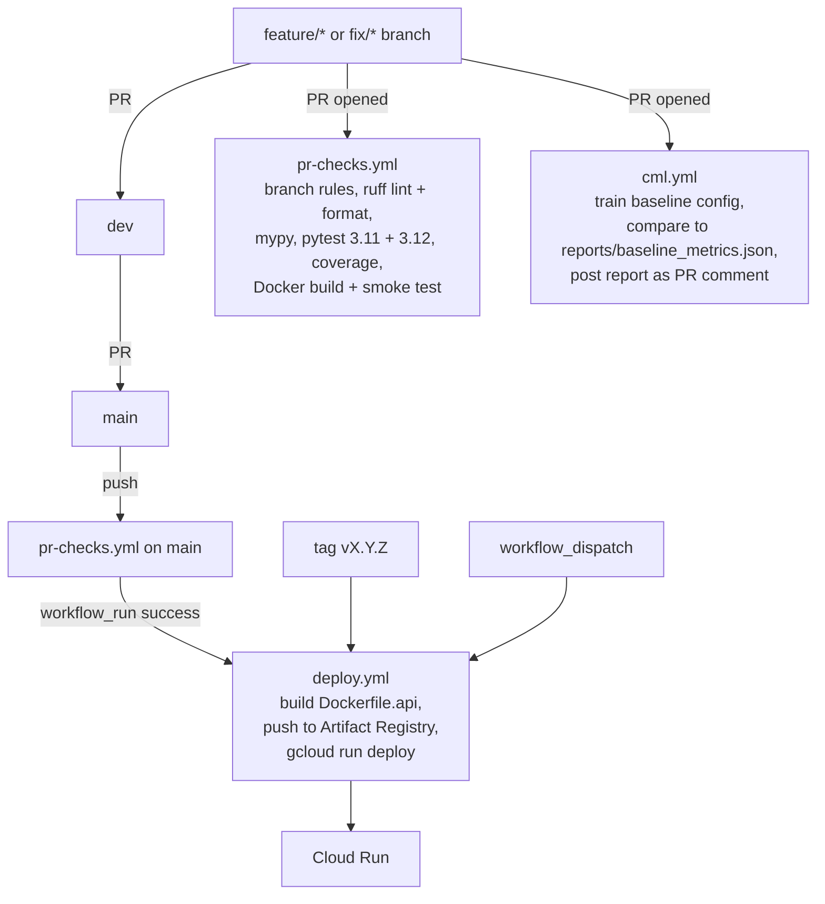

# Architecture

Four views of the system: data, training, serving, and CI/CD. All diagrams are
Mermaid and render on GitHub.

## Data pipeline

```mermaid
flowchart LR
    K[(Kaggle<br/>Zomato delivery dataset)] --> G[(GCS bucket<br/>data/raw/zomato_dataset.csv)]
    G -->|gcsfs, data.source_uri| S[temporal_split.py]
    S --> B[(data/processed<br/>train / val / test<br/>first 40 days, 70/15/15)]
    S --> W[(data/processed<br/>week1..weekN<br/>later weeks for drift)]
    B -. DVC .dvc pointers .-> R[(DVC remote)]
    B --> Q[tests/test_data_quality.py<br/>nulls, ranges, coordinates]
```

The split is chronological so the model never sees orders from after its
training window. Later weeks are kept back as simulated production traffic for
drift checks (`scripts/drift_simulation.py`).

## Training pipeline



## Serving



## CI/CD


